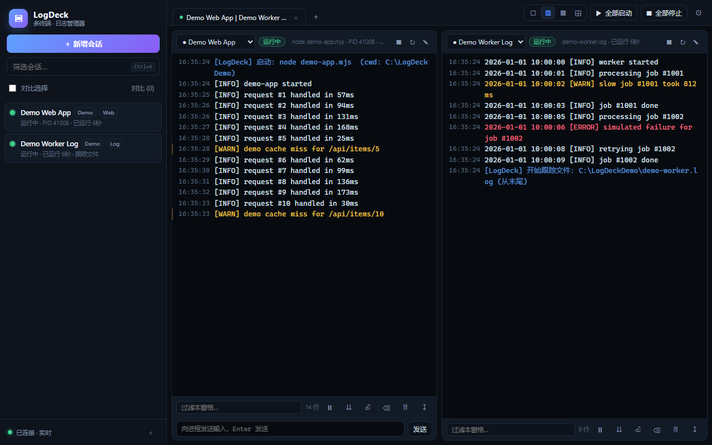

# LogDeck 日志管理器（AstrBot 插件）

把多个后台终端 / 服务窗口收进一个本机 WebUI：进程在后台跑，日志实时汇总，可以按标签查看、
1~4 窗格分栏对比、搜索过滤、随时新增终端或日志文件跟踪；同时把同一套能力通过 LLM 工具交给 AstrBot agent。

> **⚠️ AI 生成声明：本项目（Python 插件 + Node.js 管理器 + WebUI + 文档）由 LLM（DeepSeek Harness）生成，开发机做过功能测试，但不是安全审计过的软件。使用前请自行审查代码（详见 NOTICE_AI_GENERATED.md）。**

## 特点

- **纯 WebUI**：浏览器打开即用，不创建任何桌面窗口、快捷方式或托盘程序。
- **后台进程托管**：启动任意命令，捕获 stdout/stderr，记录日志文件；支持自动重启、停止、重启。
- **日志文件跟踪**：直接 tail 某个日志文件（Windows、Linux 路径均可）。
- **多标签 + 分栏对比**：一个标签页可 1/2/3/4 个窗格，每格独立选会话、过滤、暂停、跟随、自动换行。
- **实时日志**：SSE 推送，ANSI 颜色解析，按级别着色（错误红 / 警告黄 / INFO 正常 / DEBUG 灰）。
- **端口健康检查**：TCP 或 HTTP 检查，会话列表和窗格顶部显示正常/异常。
- **外部启动自动接管（可选）**：按会话配置的 takeoverPatterns 结束外部启动的重复进程，并改为由 LogDeck 托管启动；默认不启用规则。
- **AstrBot agent 工具**：查看会话、读日志、搜索、新建进程/日志跟踪、启停/重启、健康检查等。
- **本机安全**：管理器只监听 127.0.0.1，所有 API 需要随机访问令牌；令牌首次运行自动生成。

## 结构

    astrbot_plugin_log_manager/       ← AstrBot 插件根目录
    ├─ main.py                        插件入口（LLM 工具 + 聊天命令）
    ├─ logdeck_client.py              LogDeck HTTP 客户端
    ├─ logdeck_launcher.py            启动/等待内置 Node 管理器（仅标准库）
    ├─ _conf_schema.json              插件配置
    ├─ metadata.yaml
    ├─ logdeck/                       内置 LogDeck 管理器（Node.js，无第三方 npm 依赖）
    │  ├─ server.js · lib/ · public/  后端 + WebUI
    │  └─ package.json
    ├─ examples/                      DEMO 用的小程序与假日志（用于截图/试用）
    ├─ docs/API.md                    HTTP API / SSE 文档
    └─ test/                          自动化测试（独立端口 + 临时目录）

## 环境要求

- AstrBot（4.x）
- **Node.js 18+**（内置管理器用 Node 运行；插件会自动从 PATH 找 node，也可在配置里填 node_path）
- 插件管理器与 AstrBot 在同一台机器上（默认只监听 127.0.0.1）

## 安装

1. 把整个 astrbot_plugin_log_manager 文件夹放到 AstrBot 的 data/plugins/ 下。
2. 启动/重载 AstrBot。首次加载时插件会：
   - 在插件数据目录创建 logdeck/config.json（含随机 token）和 LogDeck 数据目录；
   - 用 Node.js 在后台启动内置管理器；
   - 等待 http://127.0.0.1:17890/api/info 就绪。
3. 浏览器打开 http://127.0.0.1:17890/ 即可使用（页面自动携带本机令牌）。
   在聊天里也可以发 /logmgr web 获取地址。

如果 Node 不在 PATH，可在 AstrBot 插件配置里填 node_path；如果关闭 auto_start，
插件就只连接你手动运行的 LogDeck（这时需要填对 manager_url 和 token）。

管理器数据默认保存在 AstrBot 的 data/plugin_data/astrbot_plugin_log_manager/logdeck/：
config.json（会话与令牌）、data/logs/*.log、manager-launch.log。

## WebUI 用法

- 左侧会话列表：绿点=运行中，灰/红=停止或异常；勾选「对比选择」后点「对比」分栏。
- 顶栏：标签页、1/2/3/4 分栏、全部启动/停止、设置。
- 窗格底部：过滤、暂停、跟随、自动换行、清屏、清空日志、下载日志。
- 「＋ 新增会话」支持：
  - 运行命令：填入命令和工作目录，创建后即可在后台运行并收集日志；
  - 跟踪日志文件：填入日志文件路径，从末尾开始 tail。
- 编辑器「高级选项」可设置：环境变量、PATH 前置、自动重启策略、端口健康检查、
  外部启动接管关键词（逗号分隔，留空=不接管）。

快捷键：Ctrl+T 新建标签、Ctrl+W 关闭标签、Ctrl+K 搜索会话、Ctrl+F 过滤窗格、
Alt+1..4 切换分栏、Ctrl+1..9 切换标签。

## agent 工具

只读（默认所有人可用，可用 require_admin_read 收紧）：

| 工具 | 作用 |
| --- | --- |
| logmgr_list_sessions | 列出所有会话、状态、PID、端口健康、标签 |
| logmgr_read_logs | 读某会话最近日志，支持行数与关键字过滤 |
| logmgr_search_logs | 在所有会话（或指定会话）里搜索 |
| logmgr_health | 管理器在线状态 + 每个会话状态/端口健康 |

管理（默认仅 AstrBot 管理员）：

| 工具 | 作用 |
| --- | --- |
| logmgr_create_session | 新建后台终端会话（命令、工作目录、自动启动等） |
| logmgr_add_log_file | 新建日志文件跟踪会话 |
| logmgr_manage_session | start / stop / restart |
| logmgr_delete_session | 删除会话（默认关闭 allow_delete） |
| logmgr_clear_logs | 清空日志（默认关闭 allow_clear） |
| logmgr_send_input | 向进程 stdin 发送一行（默认关闭 allow_input） |

## 聊天命令

    /logmgr help
    /logmgr list
    /logmgr tail <id|名称> [行数] [--grep 关键词]
    /logmgr search <关键词>
    /logmgr health
    /logmgr web
    /logmgr start|stop|restart <id|名称>
    /logmgr new <名称> | <命令> [| 工作目录]
    /logmgr file <名称> | <日志路径>

管理类命令需要 AstrBot 管理员身份。

## 配置

| 字段 | 默认 | 说明 |
| --- | --- | --- |
| manager_url | http://127.0.0.1:17890 | LogDeck WebUI/API 地址 |
| token | 空 | 访问令牌；留空自动生成。连接已有管理器时填它的 token |
| auto_start | true | 插件加载时自动启动内置管理器 |
| node_path | 空 | Node.js 路径；留空从 PATH 查找 |
| start_timeout | 25 | 等待管理器就绪的秒数 |
| request_timeout | 10 | HTTP 请求超时 |
| default_lines / max_lines | 80 / 300 | 读日志默认/最大行数 |
| require_admin_read | false | 读日志是否需要管理员 |
| require_admin_manage | true | 管理操作是否需要管理员 |
| allow_manage / allow_create | true | 是否允许 agent 启停/新建 |
| allow_delete / allow_clear / allow_input | false | 危险操作开关 |

## 安全与隐私

- 管理器只绑定 127.0.0.1，不对外网开放；API 需要随机 token（首次运行生成，保存在插件数据目录）。
- 插件的 WebUI 与 agent 工具共用同一个本地管理器；WebUI 页面由本机服务注入 token，不需要手动登录。
- 所有日志与会话配置都保存在本机插件数据目录，不上传任何地方；但日志本身可能包含敏感信息，请自行保护数据目录和 WebUI 端口。
- 危险工具默认关闭；管理工具默认要求 AstrBot 管理员。
- 插件可以启动任意命令、结束进程、读取文件——请只在可信环境使用，不要给不可信用户开放管理员。
- 管理器由插件在后台启动后会常驻；重载/重启 AstrBot 不会重复启动，插件会先探测已有实例再连接。如需彻底停止，请手动结束对应 node 进程。

## 开发与测试

内置管理器是零第三方依赖的原生 Node 项目：

    cd logdeck
    copy config.example.json config.json       # Windows（Linux/macOS 用 cp）
    node server.js --config ./config.json

自动化测试（独立端口 + 临时目录，不会碰真实配置）：

    node test/smoke.mjs
    node test/takeover.mjs

API 文档：docs/API.md。

## License

MIT，详见 LICENSE。生成声明见 NOTICE_AI_GENERATED.md。
